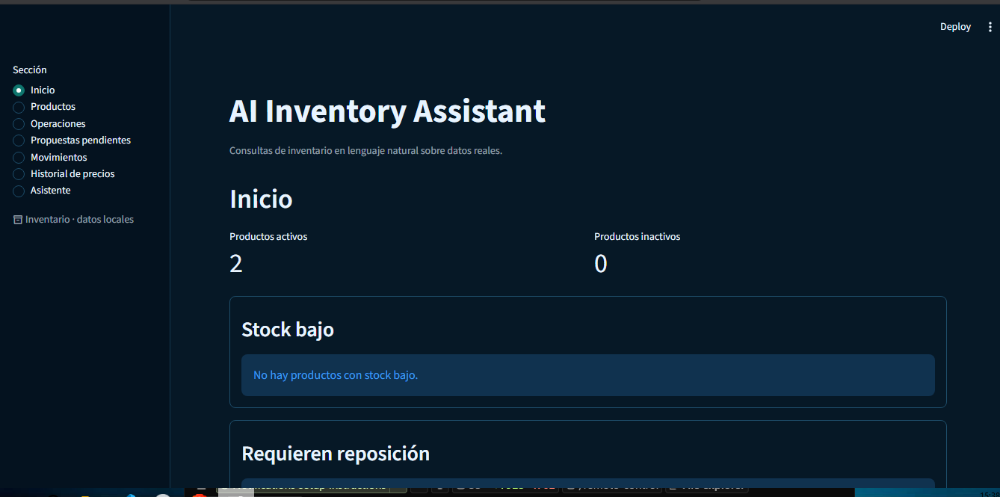
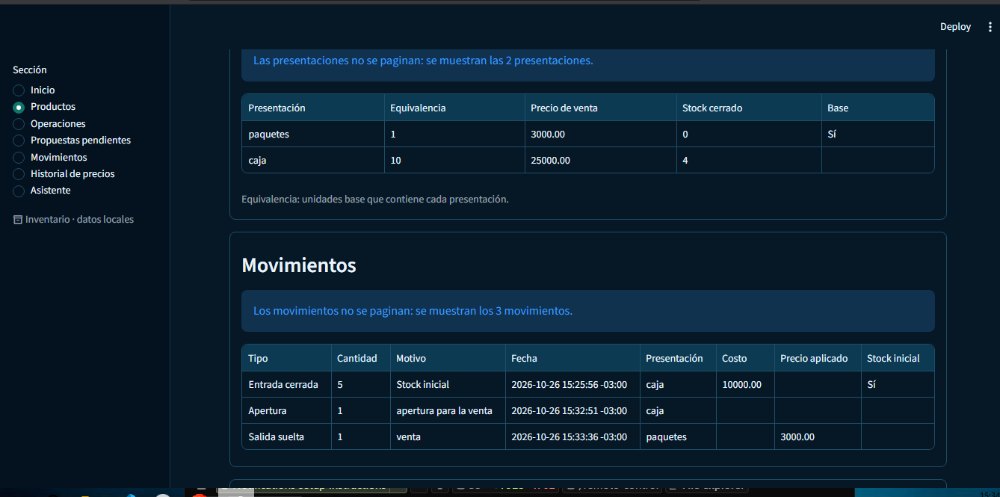
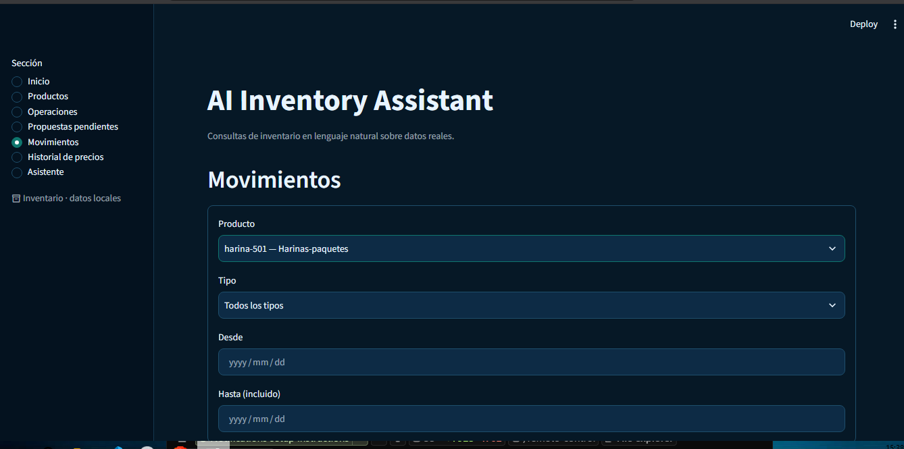
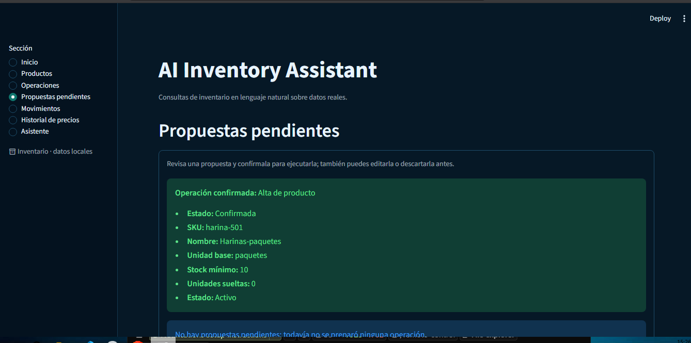
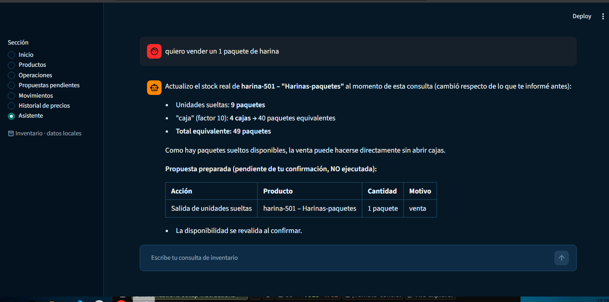
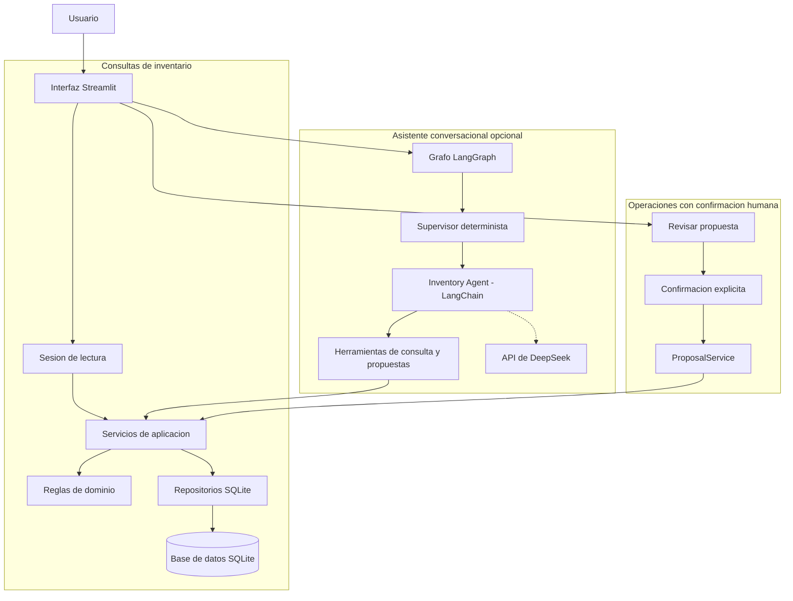

# AI Inventory Assistant

<div align="center">

**Gestión de inventario con lenguaje natural, reglas de negocio deterministas y confirmación explícita.**

[](https://www.python.org/)
[](https://www.langchain.com/langgraph)
[](https://www.langchain.com/)
[](https://www.deepseek.com/)
[](https://streamlit.io/)
[](https://sqlite.org/)
[](https://docs.pydantic.dev/)
[](LICENSE)

</div>

---

## Tabla de contenidos

- [Descripción](#descripción)
- [El problema que resuelve](#el-problema-que-resuelve)
- [Para quién está pensado](#para-quién-está-pensado)
- [Capturas de pantalla](#capturas-de-pantalla)
- [Funcionalidades principales](#funcionalidades-principales)
- [Cómo funciona](#cómo-funciona)
- [Arquitectura](#arquitectura)
- [Componentes del sistema](#componentes-del-sistema)
- [Reglas de negocio y seguridad](#reglas-de-negocio-y-seguridad)
- [Tecnologías](#tecnologías)
- [Estructura del repositorio](#estructura-del-repositorio)
- [Requisitos previos](#requisitos-previos)
- [Instalación y configuración en Windows](#instalación-y-configuración-en-windows)
- [Ejecución](#ejecución)
- [Pruebas](#pruebas)
- [Limitaciones conocidas](#limitaciones-conocidas)
- [Autor](#autor)
- [Licencia](#licencia)

---

## Descripción

**AI Inventory Assistant** es una aplicación de gestión de inventario asistida por IA. Combina una interfaz Streamlit para consultar y operar el inventario con un asistente conversacional capaz de interpretar solicitudes en lenguaje natural, consultar datos reales y preparar propuestas de operaciones.

La aplicación está diseñada para trabajar con **productos, presentaciones, stock suelto y stock cerrado**, movimientos trazables y precios de venta. Las reglas de inventario viven en el dominio y en los servicios de aplicación; el modelo de lenguaje no calcula stock ni escribe en SQLite por su cuenta.

El asistente puede consultar el inventario y proponer operaciones, pero **no confirma ninguna operación**. La confirmación es una acción explícita del usuario en la interfaz y se ejecuta fuera del LLM, con revalidación y transacción en el servicio correspondiente.

### Distinción importante

- **Consultas:** leen productos, stock, presentaciones, alertas, movimientos e historial de precios. No modifican datos.
- **Operaciones:** se preparan como propuestas pendientes. Solo se ejecutan cuando el usuario las confirma explícitamente.

---

## El problema que resuelve

Un inventario pequeño suele terminar repartido entre planillas, mensajes y cálculos manuales. Eso dificulta responder preguntas básicas y mantener la consistencia:

- ¿Cuánto stock real hay de un producto?
- ¿Cuántas unidades sueltas y cuántas presentaciones cerradas quedan?
- ¿Qué productos requieren reposición?
- ¿Qué movimientos explican el stock actual?
- ¿Cuál es el precio vigente y cómo cambió?
- ¿Qué operación conviene preparar sin ejecutarla todavía?

AI Inventory Assistant concentra esas respuestas en una aplicación local, con datos persistidos en SQLite y reglas verificables. El asistente agrega una capa de lenguaje natural, pero la decisión final y la confirmación siguen siendo humanas.

---

## Para quién está pensado

- **Pequeños comercios y depósitos** que necesitan controlar stock sin incorporar un ERP completo.
- **Personas que gestionan inventario** y quieren consultar información en lenguaje natural sin perder trazabilidad.
- **Desarrolladores y reclutadores técnicos** interesados en una implementación concreta de agentes, herramientas, persistencia y reglas de negocio separadas.
- **Equipos que necesitan un MVP comprensible y auditable**, no una caja negra de IA.

---

## Capturas de pantalla

Las imágenes corresponden a ejecuciones de demostración con datos de prueba. Se usan tal como están en `assets/`.

### Inicio



Conteo de productos activos e inactivos, alertas de stock bajo y productos que requieren reposición.

### Detalle de producto



Presentaciones con equivalencia, precio de venta y stock cerrado; movimientos asociados al producto.

### Movimientos



Filtros por producto, tipo y período, con la tabla de movimientos resultante.

### Propuestas pendientes



Revisión de una operación confirmada y aviso del estado de las propuestas pendientes. La confirmación se realiza desde la interfaz, no desde el LLM.

### Asistente



El asistente consulta datos reales, explica el stock y prepara una propuesta pendiente sin ejecutarla.

---

## Funcionalidades principales

### Consulta del inventario

- Inicio con conteos de productos activos e inactivos.
- Alertas de stock bajo y productos que requieren reposición.
- Listado de productos con SKU, nombre, unidad base, stock mínimo, unidades sueltas, stock cerrado y estado.
- Búsqueda exacta por nombre o SKU en la sección de productos.
- Detalle de producto con presentaciones, precios, stock y movimientos.
- Movimientos filtrables por producto, tipo y período.
- Historial de precios por producto o presentación, en orden cronológico.

### Operaciones preparadas como propuestas

- Alta de producto.
- Modificación de nombre o stock mínimo.
- Alta de presentación.
- Entrada de unidades sueltas.
- Entrada de presentaciones cerradas.
- Salida de unidades sueltas.
- Salida de presentaciones cerradas.
- Apertura de presentaciones.
- Compensación de un movimiento.
- Cambio de precio de venta.

Los formularios de **Operaciones** solo crean propuestas pendientes. No ejecutan la operación ni escriben en el inventario.

### Asistente conversacional

- Interpreta solicitudes en español.
- Busca productos por nombre o SKU, con coincidencia parcial normalizada.
- Prioriza el SKU exacto y muestra todas las coincidencias.
- Pide aclaración cuando hay varias coincidencias o cuando una coincidencia parcial no identifica el producto de forma inequívoca.
- Consulta stock, presentaciones, alertas, movimientos e historial de precios.
- Prepara propuestas de operaciones sin confirmarlas.
- Conserva contexto reciente de la conversación en la sesión.
- Se degrada de forma controlada si falta la configuración del modelo: las secciones de lectura siguen funcionando.

### Revisión y confirmación

- Las propuestas pendientes se muestran en la conversación y en **Propuestas pendientes**.
- Se pueden revisar, editar y descartar localmente antes de confirmar.
- La confirmación se ejecuta desde un único punto de la interfaz.
- La operación se revalida contra el estado vigente antes de escribir.
- Un rechazo no deja cambios parciales.

---

## Cómo funciona

### 1. Composición de la aplicación

Al iniciar, la interfaz compone una sesión de lectura con:

- una conexión SQLite;
- repositorios;
- servicios de productos, presentaciones, inventario, movimientos, precios y propuestas.

La composición de lectura no necesita el modelo. El asistente se compone por separado y solo cuando existe configuración de DeepSeek. Si falta la API key o el identificador del modelo, la conversación no se habilita, pero las secciones de consulta siguen disponibles.

### 2. Entrada del usuario

El usuario interactúa desde una de las siete secciones de Streamlit:

1. Inicio
2. Productos
3. Operaciones
4. Propuestas pendientes
5. Movimientos
6. Historial de precios
7. Asistente

En el asistente, el mensaje se envía al grafo. En **Operaciones**, los formularios construyen payloads tipados y los convierten en propuestas.

### 3. Contexto conversacional

El asistente conserva un historial reciente en `Assistant.history`, dentro de `st.session_state`:

- cada turno guarda el mensaje del usuario y el estado real del grafo;
- antes de invocar el grafo, se reconstruyen pares `("human", ...)` y `("ai", ...)`;
- se envían como máximo **12 mensajes en total**, incluido el mensaje actual;
- el mensaje actual se agrega una sola vez;
- el historial no se persiste en SQLite y se pierde al cerrar la sesión.

Esto permite que una respuesta breve como «sí, es ese» retome la consulta pendiente de una aclaración anterior.

### 4. Grafo y agentes

El flujo implementado es:

```text
START → Supervisor → Inventory Agent → END
```

- **Supervisor:** router determinista. El MVP tiene un único destino, el Inventory Agent; no consulta al LLM para enrutar.
- **Inventory Agent:** agente LangChain construido con `create_agent`. Interpreta la solicitud y decide qué herramientas invocar.
- El agente no confirma operaciones y no escribe directamente en SQLite.

### 5. Herramientas

El agente recibe 18 herramientas:

- **7 herramientas de consulta:** búsqueda por nombre/SKU, búsqueda exacta por SKU, stock, presentaciones, stock bajo, reposición e historial de movimientos.
- **11 herramientas de propuesta:** diez acciones de propuesta y una herramienta para editar una propuesta pendiente.

Las consultas leen a través de `InventoryService`, que a su vez usa repositorios. Las propuestas delegan en `ProposalService`; crear o editar una propuesta no persiste movimientos ni modifica saldos.

### 6. Consultas de lectura

Una consulta típica sigue este recorrido:

1. El usuario pregunta, por ejemplo, por el stock de un producto.
2. El agente busca el producto.
3. Si la identificación es ambigua, pide aclaración.
4. Invoca la herramienta de lectura correspondiente.
5. La herramienta llama al servicio de inventario.
6. El servicio lee SQLite mediante repositorios y devuelve datos reales.
7. El agente responde con esos datos.

Las consultas no abren transacciones de escritura.

### 7. Propuestas de operación

Cuando el usuario pide una operación, el agente puede preparar una propuesta estructurada. La propuesta:

- nace en estado `pendiente`;
- contiene la acción y su payload tipado;
- no escribe en el inventario;
- no se persiste en la tabla `proposals`;
- se conserva en el estado del turno y en la sesión de la interfaz.

La interfaz puede mostrar la propuesta, editarla o descartarla localmente. Editar una propuesta no cambia su acción ni escribe datos.

### 8. Confirmación explícita

La confirmación es una acción de la interfaz, fuera del LLM:

1. El usuario pulsa el control de confirmación.
2. La interfaz invoca `ProposalService.confirm`.
3. El servicio de destino revalida las reglas con el estado vigente.
4. La operación se ejecuta dentro de una transacción `BEGIN IMMEDIATE`.
5. Si todo es válido, se confirma y se registra el movimiento o cambio.
6. Si algo falla, se revierte todo y se muestra el motivo.

La confirmación no se puede delegar al agente. La interfaz impide el reenvío mientras una confirmación está en curso, pero esa protección es local a la sesión y no una idempotencia durable.

### 9. Consistencia del stock

- Las cantidades son enteras.
- Los saldos persistidos son `loose_units` por producto y `closed_stock` por presentación.
- El total equivalente se deriva: `loose_units + Σ(closed_stock × factor)`.
- El total equivalente no se persiste como un saldo independiente.
- Las operaciones de stock validan la disponibilidad vigente y no permiten stock negativo.
- Las escrituras usan transacciones y claves foráneas activas.
- Las aperturas y salidas cerradas consumen entradas cerradas con lógica FIFO.
- Las compensaciones se vinculan al movimiento original y respetan la cantidad compensable.

### 10. Respuesta al usuario

La interfaz muestra:

- la respuesta textual del agente;
- los datos reales consultados;
- las propuestas pendientes y su estado;
- el resultado de una confirmación o el motivo del rechazo;
- avisos explícitos de carga, vacío, validación y error.

---

## Arquitectura

El siguiente diagrama muestra el recorrido principal de las consultas y de las operaciones. El asistente interpreta solicitudes y prepara propuestas; los servicios aplican las reglas de negocio y la interfaz solicita la confirmación explícita antes de ejecutar una escritura.





**Flujo resumido:** Usuario → Streamlit → (consultas a servicios y SQLite / asistente LangGraph con DeepSeek) → propuesta pendiente → revisión y confirmación humana → servicios y transacción SQLite.

La arquitectura separa deliberadamente:

- la **interfaz** que compone y presenta;
- los **agentes** que interpretan y proponen;
- los **servicios** que aplican casos de uso;
- el **dominio** que contiene las reglas;
- la **infraestructura SQLite** que persiste y migra.

El agente no accede a la base de datos. La única ruta de escritura del inventario es la confirmación explícita del usuario.

---

## Componentes del sistema

| Componente | Responsabilidad |
|---|---|
| `app/ui/main.py` | Punto de entrada, navegación, composición de la sesión y confirmación centralizada. |
| `app/ui/session.py` | Conexión SQLite y servicios de lectura por sesión. |
| `app/ui/sections/` | Vistas nativas de Streamlit para cada sección. |
| `app/graph/workflow.py` | Grafo `Supervisor → Inventory Agent`, captura de propuestas y puente de estado. |
| `app/graph/state.py` | Estado compartido: mensaje, conversación reciente, propuesta y respuesta. |
| `app/agents/supervisor.py` | Router determinista de una sola página. |
| `app/agents/inventory.py` | Agente LangChain que interpreta y usa herramientas. |
| `app/tools/inventory_tools.py` | Herramientas de consulta de solo lectura. |
| `app/tools/proposal_tools.py` | Herramientas que crean o editan propuestas sin ejecutarlas. |
| `app/services/` | Casos de uso de productos, presentaciones, movimientos, precios y propuestas. |
| `app/domain/` | Reglas puras de cantidades, stock, movimientos y compensaciones. |
| `app/infrastructure/sqlite/` | Conexión, esquema, migraciones y repositorios. |
| `app/schemas/` | Contratos Pydantic de propuestas y resultados. |
| `app/prompts/` | Prompts centralizados del Supervisor y del Inventory Agent. |

---

## Reglas de negocio y seguridad

### Productos y presentaciones

- El SKU es único y no se puede modificar.
- La unicidad no distingue mayúsculas de minúsculas.
- SKU, nombre y unidad base son obligatorios y se conservan recortados, sin normalizar mayúsculas.
- La unidad base es la presentación con factor 1.
- El factor es inmutable cuando la presentación tiene stock cerrado o historial.
- Un producto desactivado conserva consultas, historial y compensaciones históricas válidas, pero rechaza operaciones nuevas y modificaciones.

### Stock y movimientos

- Las cantidades son enteras y mayores que cero.
- El stock mínimo es un entero mayor o igual que cero.
- Las salidas no pueden superar el stock disponible.
- No se permite stock negativo.
- Todo movimiento requiere motivo y fecha/hora.
- Las aperturas no son compensables.
- Las salidas cerradas no son compensables en el MVP.
- Las compensaciones no pueden encadenarse.
- Los movimientos confirmados no se editan ni se eliminan.
- Los instantes se almacenan en UTC; los períodos se interpretan en `America/Argentina/Buenos_Aires` con semántica `[inicio, fin)`.

### Precios

- El precio de venta es un `Decimal` exacto y debe ser mayor que cero.
- El cambio de precio se prepara como propuesta y se confirma explícitamente.
- El precio anterior se captura al confirmar, no al preparar la propuesta.
- El cambio de precio y su historial se registran en una única transacción.
- El historial es de solo anexado.
- El alta de un producto o presentación no se registra como cambio de precio.

### Seguridad de las operaciones

- El agente no ejecuta SQL ni escribe en la base.
- Las herramientas de propuesta no confirman.
- Los formularios no escriben: crean propuestas.
- La confirmación es explícita y está centralizada en la interfaz.
- La operación se revalida contra el estado vigente.
- Un fallo revierte la transacción completa.
- Los secretos se leen de variables de entorno; `.env` está ignorado por Git.

---

## Tecnologías

| Tecnología | Uso en el proyecto |
|---|---|
| Python 3.13 | Lenguaje del entorno de desarrollo verificado. |
| Streamlit | Interfaz web y navegación lateral. |
| LangGraph | Grafo `Supervisor → Inventory Agent`. |
| LangChain | Agente, herramientas y contratos de modelo. |
| DeepSeek | Proveedor del modelo de lenguaje mediante `ChatDeepSeek`. |
| SQLite | Persistencia local, esquema y migraciones. |
| Pydantic | Validación de payloads y contratos. |
| pytest | Pruebas unitarias, de integración, concurrencia, agentes e interfaz. |
| python-dotenv | Carga de variables de entorno. |

> **Proveedor de IA:** la aplicación está integrada con el servicio real de **DeepSeek** mediante `langchain-deepseek` y `ChatDeepSeek`. Para utilizarlo, cada persona debe configurar su propia `DEEPSEEK_API_KEY` y un `DEEPSEEK_MODEL` habilitado en su cuenta. La aplicación no incluye una clave API compartida ni activa el asistente sin esa configuración. El proyecto no contiene una integración con Google Gemini.

### Decisiones arquitectónicas relevantes

- Reglas de negocio fuera del LLM.
- Separación entre interfaz, agentes, servicios, dominio e infraestructura.
- Herramientas de solo lectura para consultas.
- Propuestas tipadas para operaciones.
- Confirmación humana fuera del agente.
- SQLite con transacciones y migraciones versionadas.
- Historial de precios de solo anexado.
- Composición dual: lectura sin modelo y asistente opcional.
- Contexto conversacional acotado y no persistente.

---

## Estructura del repositorio

```text
ai-inventory-assistant/
├── app/
│   ├── agents/                 # Supervisor e Inventory Agent
│   ├── domain/                 # Reglas puras de negocio
│   ├── graph/                  # Estado y grafo LangGraph
│   ├── infrastructure/sqlite/  # Conexión, esquema, migraciones y repositorios
│   ├── prompts/                # Prompts centralizados
│   ├── schemas/                # Contratos Pydantic
│   ├── services/               # Casos de uso
│   ├── tools/                  # Herramientas de consulta y propuesta
│   └── ui/
│       ├── main.py             # Entrada y composición
│       ├── session.py          # Sesión de lectura
│       └── sections/           # Vistas Streamlit
├── assets/                     # Capturas de pantalla
├── data/                       # Base SQLite local (ignorada por Git)
├── docs/                       # Constitución y guías
├── specs/001-inventory-core/   # Especificación, plan y tareas
├── tests/
│   ├── unit/
│   ├── integration/
│   ├── concurrency/
│   ├── ai/
│   └── ui/
├── .streamlit/config.toml      # Tema nativo de Streamlit
├── .env.example                # Variables de entorno de ejemplo
├── requirements.txt
├── LICENSE
└── README.md
```

---

## Requisitos previos

- Windows con PowerShell.
- Python 3.13 (versión usada en el entorno actual).
- `pip`.
- Una API key de DeepSeek y el identificador de modelo habilitado en la cuenta para usar el asistente.
- No se necesita una API key para consultar las secciones de lectura.

---

## Instalación y configuración en Windows

### 1. Clonar el repositorio

```powershell
git clone https://github.com/solanomillo/ai-inventory-assistant.git
cd ai-inventory-assistant
```

### 2. Crear y activar el entorno virtual

```powershell
python -m venv .venv
.venv\Scripts\Activate.ps1
```

### 3. Instalar dependencias

```powershell
python -m pip install -r requirements.txt
```

### 4. Crear la configuración local

```powershell
Copy-Item .env.example .env
```

Editar `.env` y completar:

```env
APP_NAME=AI Inventory Assistant
APP_VERSION=0.1.0

DEEPSEEK_API_KEY=tu_api_key
DEEPSEEK_MODEL=tu_modelo_habilitado

# Opcional: ruta alternativa para SQLite.
# Si se omite, se usa data/inventory.sqlite3.
INVENTORY_DB_PATH=
```

No incluyas claves reales en el repositorio. `.env` está excluido por `.gitignore`.

### Configuración de la base de datos

La base se abre al iniciar la aplicación:

- ruta predeterminada: `data/inventory.sqlite3`;
- ruta configurable: variable `INVENTORY_DB_PATH`;
- la ruta predeterminada es independiente del directorio de trabajo;
- el esquema y las migraciones se crean o actualizan automáticamente al abrir la base.

---

## Ejecución

Desde la raíz del proyecto y con el entorno virtual activo:

```powershell
python -m streamlit run app/ui/main.py
```

Streamlit mostrará la URL local en la terminal. La sección **Asistente** requiere `DEEPSEEK_API_KEY` y `DEEPSEEK_MODEL`; las secciones de consulta funcionan sin ellas.

---

## Pruebas

Ejecutar toda la suite:

```powershell
python -m pytest -q
```

La suite incluye pruebas:

- unitarias de dominio;
- de integración con SQLite;
- de concurrencia;
- de herramientas y agentes con modelos falsos;
- de interfaz con `AppTest`.

Las pruebas automatizadas de agentes usan modelos falsos deterministas para que sean reproducibles y no consuman cuota de API. Esto **no significa que la aplicación carezca de integración real**: el asistente de la aplicación utiliza DeepSeek cuando se configuran credenciales y un identificador de modelo válido. No se afirma que la suite automatizada valide llamadas en vivo al proveedor.

---

## Limitaciones conocidas

- **MVP de un único inventario y una única ubicación.** No hay multiusuario, autenticación ni separación por organizaciones.
- **Sin ventas, compras ni proveedores formales.** El foco es el control de stock y sus movimientos.
- **Propuestas no persistentes.** Viven en la sesión de la interfaz; no se guardan en la tabla `proposals`.
- **Confirmación sin idempotencia durable.** La interfaz evita el doble envío durante una confirmación, pero no hay un registro global que impida repetirla desde otra sesión.
- **Sin paginación.** Los listados e historiales muestran todos los registros; si exceden el espacio visible se informa.
- **Aperturas y salidas cerradas no compensables.** Es una restricción del MVP.
- **Sin desactivación de productos ni cambio de factor desde la interfaz.** Son operaciones fuera del alcance de la UI actual.
- **Tablas en viewports angostos.** En 768 px pueden usar scroll horizontal interno; es una limitación conocida de la validación visual.
- **Las llamadas en vivo a DeepSeek no forman parte de la suite automatizada.** Las pruebas de agentes usan modelos falsos; el uso real requiere una API key y un modelo habilitado.
- **Dependencias sin versiones fijadas.** `requirements.txt` no fija versiones; para reproducibilidad conviene congelar un entorno validado.

### Mejoras futuras posibles

- Pruebas de integración con DeepSeek real.
- Paginación o virtualización de tablas grandes.
- Idempotencia durable para confirmaciones.
- Autenticación y múltiples inventarios.
- Empaquetado o despliegue reproducible.

Estas mejoras no están implementadas en la versión actual.

---

## Autor

**Julio Solano** — Backend Developer

- GitHub: [github.com/solanomillo](https://github.com/solanomillo)
- LinkedIn: [linkedin.com/in/julio-cesar-solano](https://www.linkedin.com/in/julio-cesar-solano)
- Email: [solanomillo144@gmail.com](mailto:solanomillo144@gmail.com)

---

## Licencia

Este proyecto se distribuye bajo la **Licencia MIT**. Consulta el archivo [`LICENSE`](https://github.com/solanomillo/ai-inventory-assistant/blob/main/LICENSE) para ver el texto completo.

Copyright © 2026 [Julio Cesar Solano](https://github.com/solanomillo/) — Backend Developer.

---

<div align="center">

**AI Inventory Assistant** — inventario comprensible, operaciones explícitas y datos reales.

</div>
